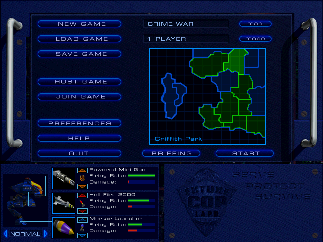

# Future Cop: L.A.P.D. — static recompilation

A native port of *Future Cop: L.A.P.D.* (EA, 1998, Windows) built by **static
recompilation**: every function of the original `FCopLAPD.exe` is translated
mechanically from x86 machine code into C, compiled with a modern compiler, and linked
against a new platform layer that replaces Win32 and DirectX with SDL2.

The game's own code runs natively: no emulator, and the original EXE is not executed.
It runs on Linux and is playable: menus, both game modes (Crime War and Precinct Assault),
two-player split screen, sound, music and videos.



**No game code or data is in this repository.** You need your own copy of the game (the
original CD). The translated C is generated at build time from your `FCopLAPD.exe` and is
never committed.

## Building on Linux

### 1. Install the tools

You need gcc, the SDL2 development files and Python 3. **gcc 15 or newer** is recommended
(it guarantees the tail calls the translated code relies on; with an older gcc, build with
`OPT=-O2 ./recomp/build.sh` instead).

| Distribution | Command |
|---|---|
| Ubuntu / Debian | `sudo apt install build-essential libsdl2-dev python3 python3-venv` |
| Fedora | `sudo dnf install gcc SDL2-devel python3` |
| Arch | `sudo pacman -S gcc sdl2 python` |

`ffmpeg` is optional (only the test tool uses it, to save screenshots).

### 2. Get the code and the Python packages

```sh
git clone <this repository> future-cop-recomp
cd future-cop-recomp
python3 -m venv .venv
.venv/bin/pip install -r requirements.txt
```

### 3. Copy the game files

Copy **the whole CD** into `game_files/`, keeping its folders. You should end up with:

```
game_files/
  FCopLAPD/
    FCopLAPD.exe
    febmp.bin
    missions/
  Video/          intro, briefing and help videos
  MISSIONS/
  setup/
  ...
```

The game folder is the one that contains `FCopLAPD.exe` (it is found automatically under
`game_files/`; you can also point to it with `FCOP_GAME_DIR=/path/to/folder`). The `Video`
folder must sit next to it, as on the CD.

### 4. Build

```sh
./recomp/build.sh
```

The first build translates the EXE into C and compiles it (about a minute on a
multi-core machine); later builds only recompile what changed. The result is
`build/recomp/fcop`.

### 5. Play

```sh
build/recomp/fcop game_files/FCopLAPD
```

Your settings, key bindings and saved games are stored in the game folder
(`registry.txt`, `controls.txt`, `save.cfg`), as the original stored them in the Windows
registry and its install folder.

## Windows

Not supported yet: the platform layer is SDL2-based and portable, but the Windows build
has not been set up or tested. It is on the list below.

## Playing

- **Menus** use the mouse. Skip videos with Esc, Space, Enter or a click.
- **Default controls** are the numeric keypad: 8 forward, 5 back, 4 / 6 turn, Space gun,
  Alt heavy weapon, Ctrl special weapon, Z jump, 2 action, 0 change target, 7 / 9 jink,
  M map, Tab camera, Esc pause. The arrow keys also move and turn. Change them in
  **Preferences > Controller Configuration**.
- **Gamepads** (any controller SDL recognises) are offered to the game as joysticks (tested with a simulated pad so far).
- **Preferences**: resolution (320x240 up to 1600x1200) and Fullscreen apply when the next
  mission starts; the menus always run at 640x480, as in the original. **Alt+Enter**
  switches between fullscreen and a window at any time; the window can be resized.

Optional environment variables:

| Variable | Effect |
|---|---|
| `FCOP_SKIP_VIDEOS=1` | Skip all videos (intro, briefings) |
| `FCOP_WINDOW_H=<pixels>` | Starting window height (default: 3/4 of the screen) |
| `FCOP_GAME_DIR=<folder>` | Where `FCopLAPD.exe` is |

## How it works

| Part | What it does |
|---|---|
| `recomp/x86c.py` | Translates every function in the EXE into C (`build/recomp/gen/`, a few seconds), including the software renderer's self-modifying code |
| `recomp/rt/` | The guest CPU state and memory model (`cpu.h`) and runtime helpers |
| `recomp/platform/` | The Win32 / DirectDraw / DirectInput / DirectSound / DirectShow functions the game imports, implemented on SDL2 against guest memory; the game's dialog boxes are drawn in its own style |
| `recomp/difftest.py` | Runs each original function in the Unicorn emulator and as recompiled C from the same random states, and compares the results |
| `recomp/plat_test.py` | Builds and runs the game headless with scripted input, for automated testing (screenshots, sound levels) |
| `data/functions.json` | Function boundaries of the EXE (from a Ghidra analysis) |

Details and milestones: [docs/RECOMP_PLAN.md](docs/RECOMP_PLAN.md).

## Status

- [x] Whole EXE recompiles and links; 1,588 functions verified identical to the original in differential tests
- [x] All 200 imported Windows functions have an implementation
- [x] Playable missions with keyboard, mouse and gamepad, sound, music and videos
- [x] The game's dialogs (preferences, controller configuration, audio, pause, load/save, quit) redrawn in the game's style
- [x] Resolutions up to 1600x1200, fullscreen, resizable window
- [ ] OpenGL renderer (the game's 3D driver interface) for sharp high resolutions and texture replacement
- [ ] Windows and Android builds

## Third-party code

- [font8x8](https://github.com/dhepper/font8x8) (public domain): the dialog font
- [pl_mpeg](https://github.com/phoboslab/pl_mpeg) (MIT): MPEG-1 video and MP2 audio decoding
